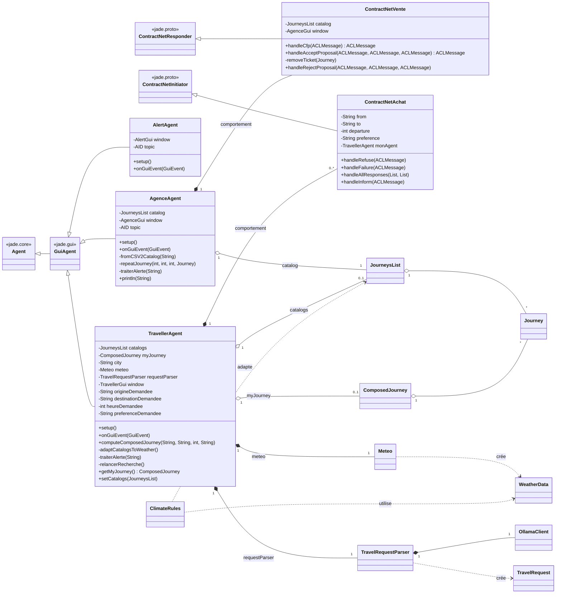
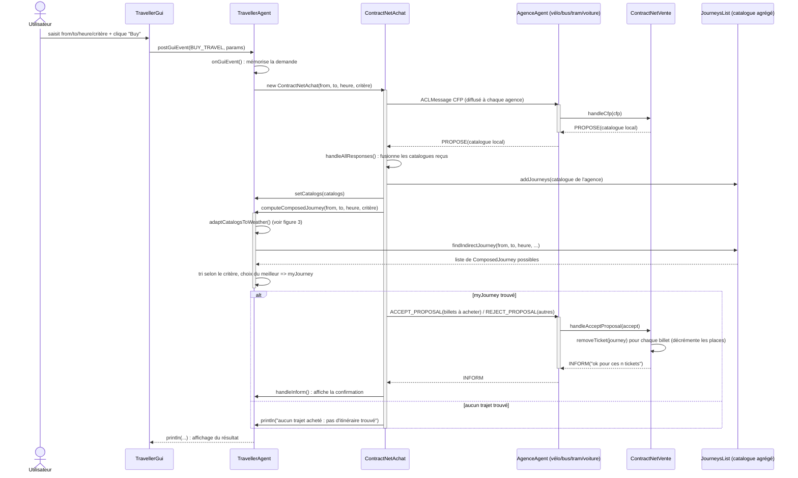
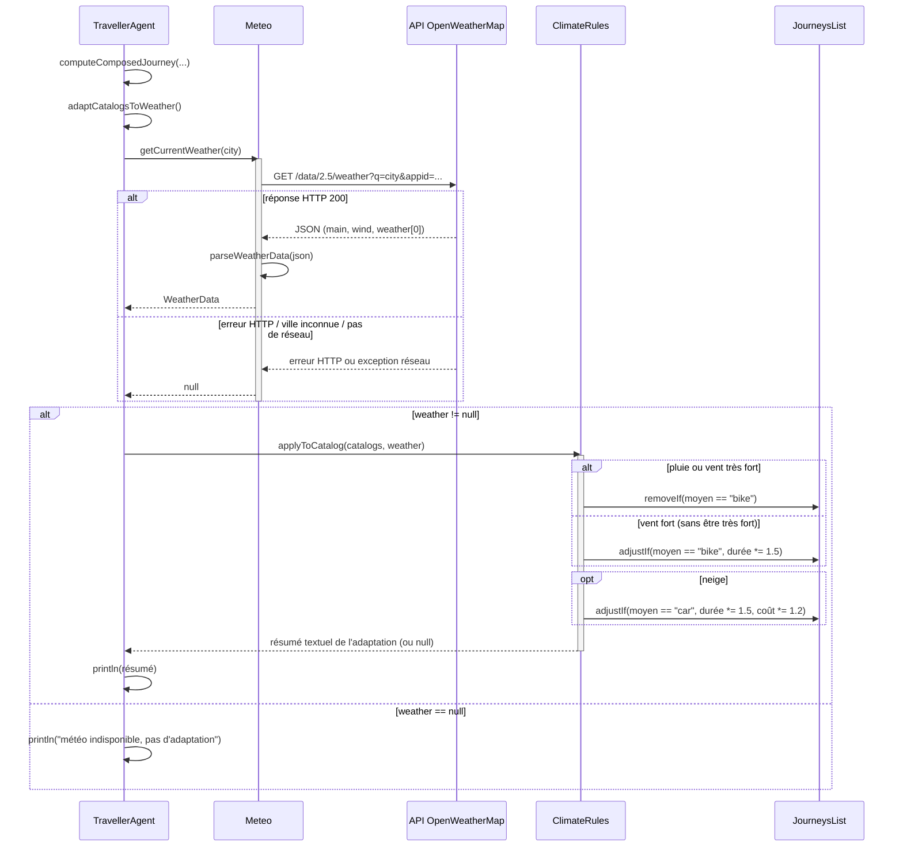
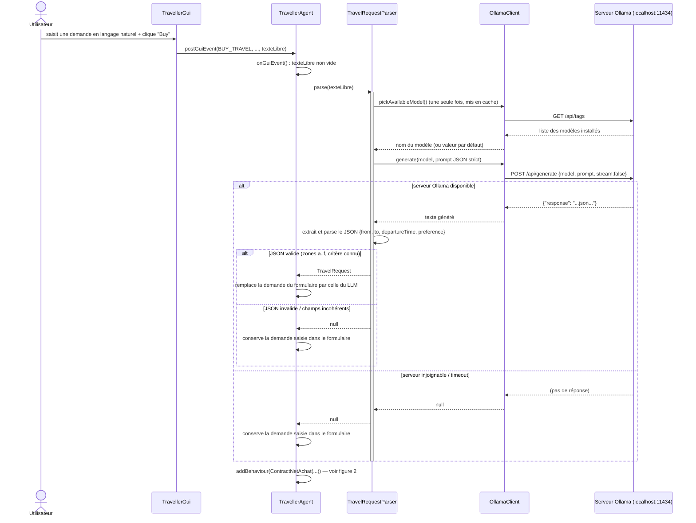

# TP : Programmation Orienté Agent  
**ANGRAND Louis, DANLOS Ludovic**

# Voyages en ville

## État d'avancement

4 améliorations proposées par le sujet

| Amélioration demandée | Statut | Implémentation |
| --- | --- | --- |
| Décrémentation du nb de places (achat et cas du vélo) | fait | `ContractNetVente.removeTicket`, `JourneysList.findIndirectJourney` |
| Prise en compte de la météo | fait | package `meteo`, `TravellerAgent.adaptCatalogsToWeather` |
| Réaction à une alerte (agence et client) | fait | `AgenceAgent.traiterAlerte`, `TravellerAgent.traiterAlerte` / `relancerRecherche` |
| Demande en langage naturel via LLM | fait — version basique | package `llm`, `TravellerAgent.onGuiEvent` |

## Architecture générale

Le code reste organisé par rôle : `agents` (les trois `GuiAgent` JADE), `comportements` (le protocole ContractNet côté agence et côté voyageur), `data` (le catalogue de trajets et leur composition), `gui` (les fenêtres Swing), et deux packages ajoutés pour les améliorations : `meteo` (client OpenWeatherMap et règles d'adaptation au climat) et `llm` (client Ollama et extraction d'une demande de trajet depuis du texte libre).

Le diagramme de classes ci-dessous se limite, comme demandé, aux agents et à leurs comportements, en indiquant leurs principales dépendances vers ces deux packages.

**Diagramme de classes — agents & comportements**

**Figure 1.** Les trois `GuiAgent` et leurs comportements ContractNet ; en pointillés, les dépendances ajoutées pour la météo et le LLM.

## Diagrammes de séquence

Les trois échanges clés sont détaillés séparément : la recherche et l'achat d'un voyage (protocole ContractNet complet), l'appel à l'API météo qui précède la recherche d'itinéraire, et l'appel au LLM lorsqu'une demande est formulée en langage naturel.

Fig. 2Recherche et achat d'un voyage

**Figure 2.** Les agences vélo/bus/tram/voiture sont regroupées sur une seule ligne de vie pour la lisibilité : le même échange CFP / PROPOSE a lieu avec chacune d'elles. La branche `else` couvre le garde-fou ajouté dans `ContractNetAchat` quand aucun itinéraire n'est trouvé.

Fig. 3Appel à l'API météo

**Figure 3.** Appelé à chaque recherche, avant `findIndirectJourney`, pour adapter le catalogue agrégé à la météo de la ville de l'utilisateur.

Fig. 4Appel au LLM — demande en langage naturel

**Figure 4.** Les deux branches de repli (JSON invalide, serveur injoignable) laissent la demande du formulaire inchangée : l'utilisateur n'est jamais bloqué par une indisponibilité du LLM.
